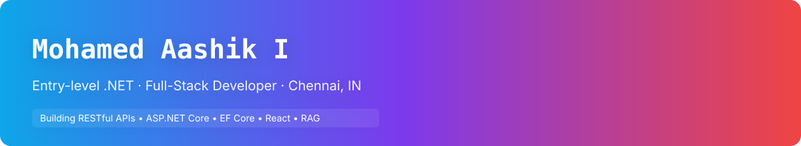

<!-- ===================== HEADER BANNER ===================== -->
<div align="center">



<a href="https://git.io/typing-svg">
  
</a>

<br/>

[](https://www.linkedin.com/in/mohamed-aashik75)
[](mailto:aashik.i2005@gmail.com)
[](https://leetcode.com/u/7sFrZzLXrr/)


</div>

---

## 👨‍💻 About Me

<table>
<tr>
<td width="60%">

```js
const aashik = {
  name: "Mohamed Aashik I",
  role: "Entry-level .NET Full-Stack Developer",
  education: "B.Tech CSBS, Mohamed Sathak Engineering College",
  cgpa: "8.08 / 10",
  location: "Chennai, Tamil Nadu 🇮🇳",
  currentlyBuilding: ["DocuMind (RAG + MCP)", "Employee Leave Management System"],
  currentlyExploring: ["RAG", "Model Context Protocol", "Gemini API"],
  openTo: "Entry-level full-stack / .NET developer roles",
};
```

</td>
<td width="40%">

- 🔧 Building RESTful APIs with **C#, ASP.NET Core & EF Core**
- ⚛️ Pairing them with **React.js** frontends
- 🔐 **JWT auth** & **role-based authorization**
- 🤖 Building **AI-powered apps** with RAG & MCP
- 📄 Published researcher in **IJEDR 2026**

</td>
</tr>
</table>

---

## 🛠️ Tech Stack

<div align="center">

### Languages & Frameworks


### Databases & Tools


<br/>


### 🤖 AI Integration


</div>

**Fundamentals:** Data Structures & Algorithms · OOP · DBMS · SDLC · Relational DB Design · Indexing & Transactions

---

## 🚀 Featured Projects

<table>
<tr>
<td width="50%" valign="top">

### 📚 DocuMind
**RAG Document Q&A with an MCP Server** · *🚧 In progress*

A full-stack document intelligence platform that answers questions from your documents with **document and page citations**.

- RAG pipeline: PDF extraction, chunking, embeddings, semantic retrieval
- C# **MCP server** exposing document search and retrieval tools
- JWT auth, user-scoped access, input validation and automated tests


</td>
<td width="50%" valign="top">

### 🗓️ Employee Leave Management System
*🚧 In progress*

An end-to-end leave workflow for **Admin, Manager and Employee** roles.

- RESTful APIs with code-first migrations and a normalized SQL Server schema
- LINQ queries with **pagination and dynamic filtering**
- React.js dashboard for applications, approvals and status tracking


</td>
</tr>
<tr>
<td width="50%" valign="top">

### 📱 QR Attendance Management System
*Aug 2026 – Oct 2026*

QR-based student **check-in / check-out** across multiple classes.

- Server-side QR validation and duplicate check-in prevention
- JWT authentication with role-based access for **Trainer** and **Student**
- MS SQL Server for student records, classes and attendance transactions


</td>
<td width="50%" valign="top">

### 📄 Research Publication
**Agri Smart** · *IJEDR, Vol. 14, Issue 2, May 2026*

Co-authored research combining **computer vision, machine learning, XGBoost and satellite-based NDVI** for crop recommendation and health monitoring.

`Publication ID: IJEDR26A2077` · `ISSN: 2321-9939`

</td>
</tr>
</table>

---

## 📊 GitHub Analytics

<div align="center">


<br/>


<br/>


</div>

---

## 🏅 Certification

| Certification | Issuer | Period | Score |
|---|---|---|---|
| ☁️ **Cloud Computing (Elite)** | NPTEL, IIT Kharagpur | Jan – Apr 2025 | 70% |

---

## 🤝 Let's Connect

<div align="center">

I'm looking for my **first full-stack developer role**, especially on **.NET + React** teams.
If you're hiring or want to collaborate, I'd love to hear from you!

[](mailto:aashik.i2005@gmail.com)
[](https://www.linkedin.com/in/mohamed-aashik75)

<br/>

*⭐ If you like what you see, drop a star on my repos!*


</div>
